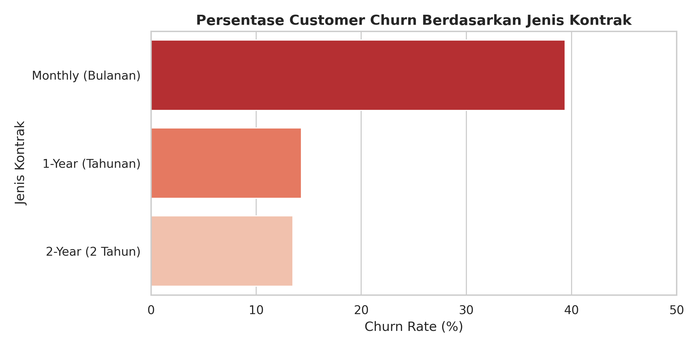
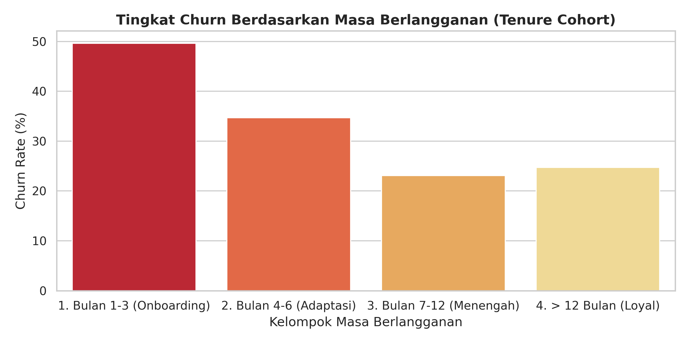
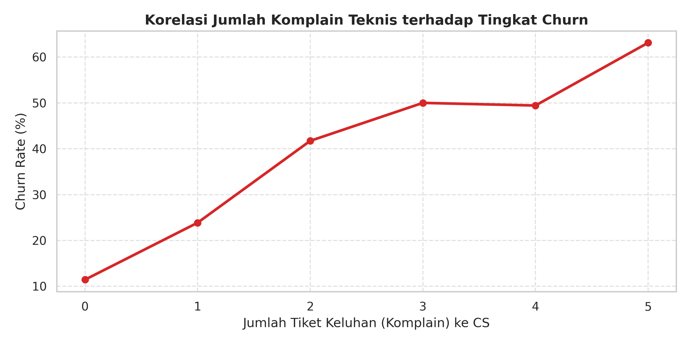

# 📉 Analisis Customer Churn & Retensi Pelanggan Layanan Berlangganan (SQL & Python)

## 📌 Latar Belakang Bisnis (Business Problem)
Dalam model bisnis berbasis langganan (*subscription business*), mempertahankan pelanggan lama jauh lebih hemat biaya dibandingkan mengakuisisi pelanggan baru. Tingginya angka berhenti berlangganan (*Customer Churn*) secara langsung mengurangi pendapatan berulang bulanan (*Monthly Recurring Revenue* / MRR).

Proyek ini menggabungkan **SQL** untuk ekstraksi dan agregasi data dari beberapa tabel berelasi serta **Python** untuk visualisasi guna menjawab tiga pertanyaan bisnis utama:
1. Segmen kontrak dan metode pembayaran mana yang menyumbang angka *churn* dan kehilangan pendapatan terbesar?
2. Pada fase bulan ke berapa (*tenure*) pelanggan paling rentan membatalkan langganan?
3. Seberapa besar pengaruh frekuensi keluhan teknis (*support tickets*) terhadap keputusan pelanggan untuk berhenti?

---

## 🛠️ Tools & Keterampilan Teknis
* **SQL (SQLite):** `INNER JOIN`, `Common Table Expressions (CTE / WITH)`, `CASE WHEN`, fungsi agregasi (`SUM`, `COUNT`, `AVG`, `ROUND`), dan pengelompokan data.
* **Python (Google Colab):** `pandas`, `sqlite3`, `matplotlib`, `seaborn`.

---

## 📊 Hasil Analisis & Insight Utama

### 1. Evaluasi Churn Berdasarkan Jenis Kontrak

* Pelanggan dengan kontrak **Bulanan (Monthly)** memiliki tingkat *churn* tertinggi (di atas 35%), jauh lebih berisiko dibandingkan pelanggan kontrak **1 Tahun** atau **2 Tahun** (di bawah 15%).

### 2. Analisis Fase Kritis Pelanggan (Tenure Cohort Analysis)

* Menggunakan *query* SQL `CTE`, ditemukan bahwa **90 hari pertama (Bulan 1–3 / Fase Onboarding)** adalah periode paling kritis dengan tingkat *churn* tertinggi. Pelanggan yang berhasil melewati bulan ke-6 cenderung bertahan lama.

### 3. Dampak Tiket Keluhan Teknis terhadap Retensi

* Hasil `INNER JOIN` antara tabel langganan dan tabel layanan pelanggan menunjukkan lonjakan tajam angka *churn* ketika pelanggan mengajukan **lebih dari 2 tiket komplain**.

---

## 💡 Rekomendasi Strategis (Actionable Recommendations)

1. **Insentif Migrasi dari Kontrak Bulanan ke Tahunan:**
   Berikan promo diskon (misalnya *"Bayar 10 Bulan untuk Langganan 1 Tahun"*) khusus kepada pelanggan paket bulanan guna mengunci komitmen jangka panjang dan menekan volatilitas *churn*.
2. **Program Pendampingan 90 Hari Pertama (Onboarding Care):**
   Fokuskan pesan edukasi fitur dan penawaran pengingat penggunaan pada pelanggan di bulan ke-1 hingga ke-3 agar mereka merasakan manfaat layanan secara maksimal sejak awal.
3. **Sistem Peringatan Dini (Early Warning System) pada Layanan CS:**
   Integrasikan data tiket keluhan dengan tim retensi. Ketika seorang pelanggan mengajukan komplain kedua kalinya, berikan penanganan prioritas (*fast-track resolution*) atau kompensasi kuota/diskon bulan berikutnya sebelum mereka memutuskan berhenti.

---

## 📂 Struktur File di Repository Ini
* `Subscription_Churn_SQL_Analysis.ipynb` — Notebook interaktif berisi pembuatan skema database, eksekusi *query* SQL, dan visualisasi Python.
* `churn_analysis_queries.sql` — Kumpulan *script* SQL murni (`JOIN`, `CTE`, `CASE WHEN`) yang digunakan dalam analisis.
* `*.png` — Grafik hasil visualisasi temuan.
